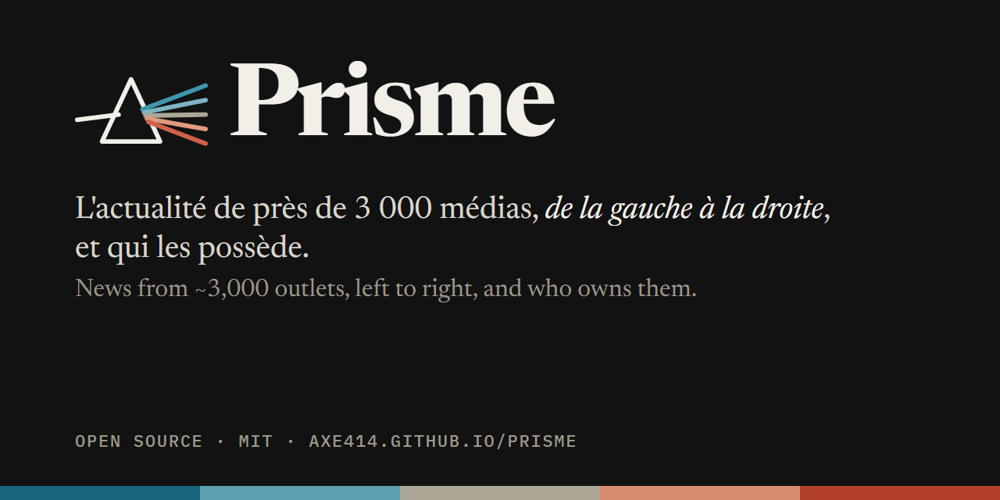
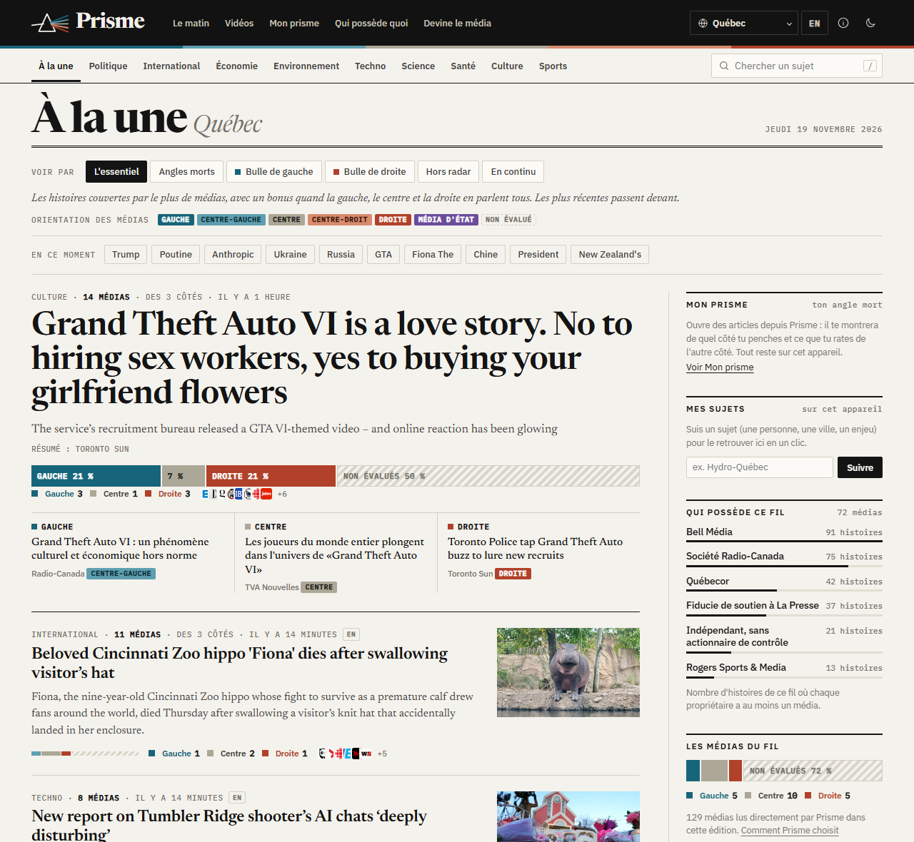
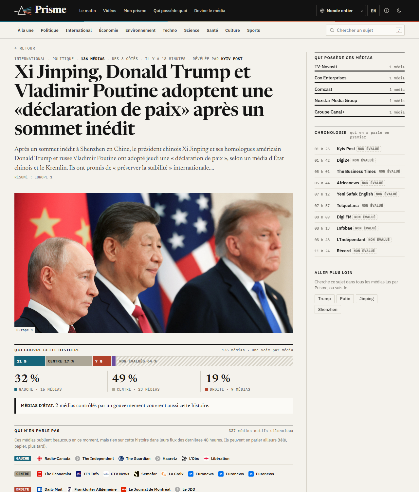
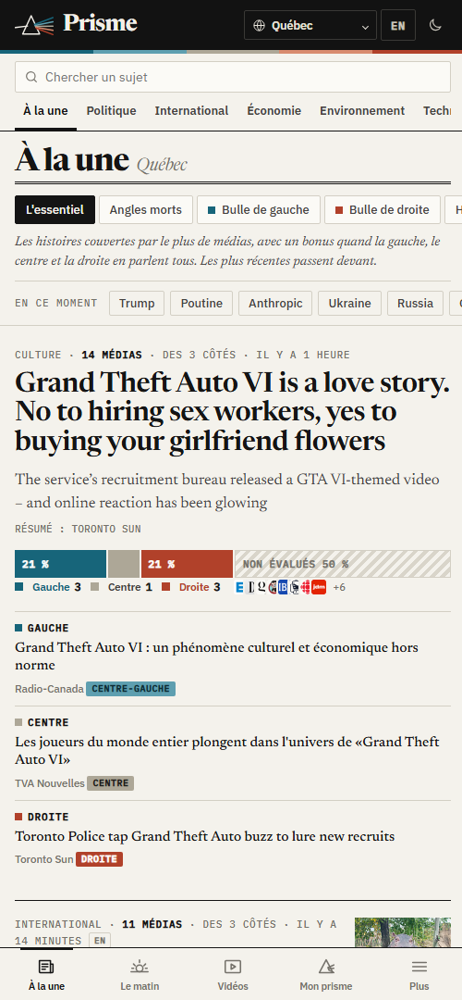

<p align="center"></p>

<p align="center">
  <b><a href="https://axe414.github.io/prisme/">▶ Ouvrir Prisme / Open Prisme</a></b><br>
  <sub>Français · <a href="#english">English below</a></sub>
</p>

# Prisme

**L'actualité de près de 3 000 médias, de la gauche à la droite, et qui les possède.**

Prisme lit lui-même les flux publics de près de 3 000 médias dans environ 70 pays, regroupe leurs articles en histoires, et montre pour chacune **qui la couvre** (gauche, centre, droite, médias d'État), **qui possède ces médias**, **qui se tait**, et **comment chaque camp la titre**. Aucun agrégateur ne trie les nouvelles à sa place, et il n'y a ni serveur ni publicité : un robot GitHub prépare les éditions toutes les 30 minutes.

| La une | Une histoire | Sur téléphone |
|---|---|---|
|  |  |  |

## Ce que Prisme fait

- **Des histoires, pas des articles** : les articles qui racontent le même évènement sont regroupés, même d'une langue à l'autre. Un média compte pour une voix.
- **Gauche, centre, droite en clair** : chaque média porte son orientation écrite en toutes lettres ; chaque histoire montre sa répartition.
- **Angles morts** : les histoires qu'un côté couvre et que l'autre ignore.
- **Qui n'en parle pas** : les grands médias actifs qui se taisent sur une histoire.
- **Mots chargés** : les mots qu'un seul camp emploie, surlignés dans les titres.
- **Vu d'ici, vu d'ailleurs** : la même histoire vue du Canada, de la France, des États-Unis, du Royaume-Uni et d'ailleurs.
- **Titres modifiés** : Prisme garde le premier titre et montre quand un média le change.
- **Qui possède quoi** : la carte des propriétaires (familles, groupes) et de leurs médias.
- **Mon prisme** : ton propre angle mort, calculé à partir de ce que tu lis (gardé sur ton appareil seulement).
- **Le matin**, **Vidéos** (chaînes YouTube des médias, sans clé), **Devine le média** (quiz), **résumés neutres** par IA, **12 éditions** (du Québec au monde entier), **français ou anglais**, et une **app installable** sur téléphone.

## Les données (réutilisables)

| Fichier | Contenu |
|---|---|
| [`data/media.csv`](data/media.csv) · [`.json`](data/media.json) | Les médias connus : orientation indicative, propriétaire, pays, type |
| [`data/feeds.csv`](data/feeds.csv) | Les ~2 900 flux RSS lus par Prisme (base et découverts), par pays et langue |
| [`public/empires.json`](public/empires.json) | Ce que possède chaque groupe, selon Wikidata |

Les orientations sont **indicatives** : elles s'inspirent des évaluations publiques (AllSides, Media Bias/Fact Check, Ad Fontes Media) et résument un média entier, pas chaque article. Les médias découverts automatiquement sont « non évalués ». Une erreur ? [Propose une correction](../../issues/new/choose).

## Comment ça marche

```
GitHub Actions (toutes les 30 min)                    GitHub Pages
┌──────────────────────────────────────────────┐      ┌──────────────────────┐
│ lib/ingest.mjs   lit ~2 900 flux RSS          │      │ public/ : l'app      │
│ lib/cluster.mjs  regroupe en histoires        │ ───▶ │ data/   : les éditions│
│ lib/edition.mjs  prépare 12 éditions          │      │ (fichiers statiques) │
│ lib/summarize.mjs résumés neutres (Gemini)    │      └──────────────────────┘
└──────────────────────────────────────────────┘
```

- **Aucune dépendance côté app** : HTML, CSS et JavaScript simples (`public/`).
- **Les sources** : environ 130 médias de base (`lib/sources.mjs`, `lib/media-db.mjs`) et des milliers de médias découverts automatiquement (`tools/discover-sources.mjs` → `data/sources-auto.json`).

### En local

```
npm install
npm run dev        # puis http://localhost:8888
```

Optionnel : une clé Gemini gratuite dans `.env` (voir `.env.example`) pour les résumés neutres.

## Contribuer

Les contributions sont bienvenues, surtout pour **ajouter des médias** et **corriger des orientations ou des propriétaires**. Voir [CONTRIBUTING.md](CONTRIBUTING.md).

## Licence

[MIT](LICENSE) : libre de réutiliser, modifier et partager, en gardant la mention de licence.

---

<a name="english"></a>

# Prisme (English)

**News from nearly 3,000 outlets, left to right, and who owns them.**

Prisme reads the public feeds of nearly 3,000 news outlets in about 70 countries, groups their articles into stories, and shows for each one **who covers it** (left, center, right, state media), **who owns those outlets**, **who stays silent**, and **how each side headlines it**. No aggregator decides what you see; there's no server and no ads: a GitHub robot builds every edition every 30 minutes.

**Features:** stories instead of articles (across languages) · left/center/right spelled out for every outlet · blindspots · who's silent · loaded words highlighted · seen from here and abroad · changed headlines · ownership map · *My prism* (your own reading blindspot, stored on your device only) · morning brief · videos from outlets' YouTube channels (no API key) · *Guess the outlet* quiz · AI neutral summaries · 12 editions from Quebec to the whole world · French or English interface · installable phone app.

**Reusable data:** [`data/media.csv`](data/media.csv) (known outlets: indicative leaning, owner, country, type), [`data/feeds.csv`](data/feeds.csv) (~2,900 RSS feeds by country and language), [`public/empires.json`](public/empires.json) (what each group owns, from Wikidata). Leanings are **indicative**, inspired by public ratings, and summarize a whole outlet rather than each article.

**Run locally:** `npm install && npm run dev`, then open http://localhost:8888.

**Contributing:** adding outlets and correcting leanings or owners is the most helpful thing you can do — see [CONTRIBUTING.md](CONTRIBUTING.md).

**License:** [MIT](LICENSE).
